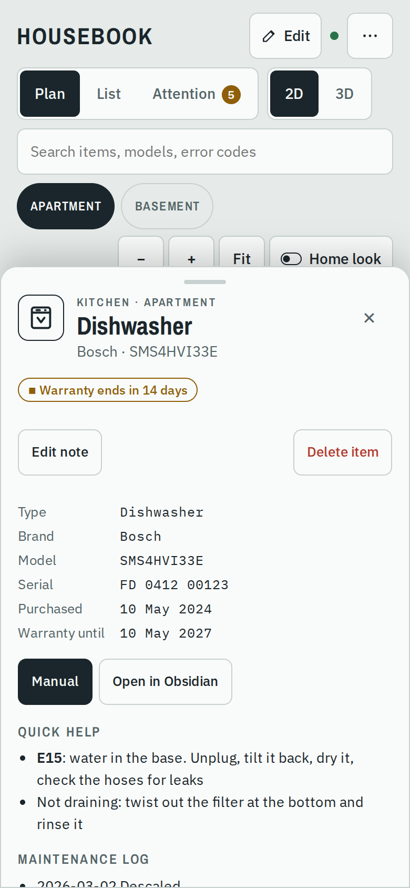

# Housebook

Self-hosted household app: a plan of your home where clicking an appliance shows its manual,
warranty, quick fixes and maintenance log. Item info is plain Markdown with YAML frontmatter
(Obsidian-compatible, Obsidian optional); the layout is `house.json`. One Docker container,
one household.


<table>
  <tr>
    <td width="66%" valign="top">
      <br>
      <sub>The 3D view with the home look (floor and wall finishes)</sub><br><br>
      <br>
      <sub>Attention: overdue checks and warranties ending soon (dark mode)</sub>
    </td>
    <td width="34%" valign="top">
      <br>
      <sub>On a phone</sub>
    </td>
  </tr>
  <tr>
    <td colspan="2">
      <br>
      <sub>The printable emergency sheet: where the fuse box, router and water valve are, and what to do</sub>
    </td>
  </tr>
</table>

Screenshots show the example house in `examples/house` (finishes added for the 3D view).

Status: milestones 0–5: the data contract; the web UI with 2D plan, list, details, search and the
3D view; writes (`PUT /api/house`, item create/patch/delete/log), the file watcher, server-sent
events, live sync and the problems panel (milestone 4); and the **layout editor** (milestone 5):
edit mode for editors with paint/erase (rectangle drag), place/move/rotate items, rooms, resizing
the house, undo/redo, debounced saving with replay on `412`, the Unplaced tray and ghost relinking,
in 2D and 3D. Milestone 6 (see `docs/ROADMAP.md`): **first-run setup** on an empty data folder, the **note editor** (edit an
item's fields and notes in the app) **deleting items** (to the trash) and
**uploading attachments** (photos lose their GPS data; HEIC becomes JPEG). Milestone 7: **editing floors** (add,
rename, reorder, delete; the floor below shown while drawing) and **door and window tools**. See `apps/web/README.md`.

```
contract/           shared by backend and frontend
  house.schema.json   generated from the Pydantic model
  catalog.json        item types
  fixtures/           golden status and search cases (run by pytest and vitest)
apps/api/           FastAPI backend (uv project)
apps/web/           React SPA (pnpm project; see apps/web/README.md)
examples/house/     example data root: house.json + House/<Room>/<Item>.md
docs/DESIGN.md      design and architecture review
docs/data-contract.md   house.json v1, frontmatter, status, search, problems
docs/login.md       choosing and setting up login
docs/backup.md      backing up and restoring the data folder
docs/releasing.md   versions, the changelog and cutting a release
```

## Run locally

Working on the code? `make setup && make dev` starts the backend and the frontend together on a
throwaway copy of the example data; see [CONTRIBUTING.md](CONTRIBUTING.md). The rest of this
section runs the backend on its own.

Requires [uv](https://docs.astral.sh/uv/) (it fetches Python 3.13 if needed).

```sh
cd apps/api
uv sync
HOUSEBOOK_DATA_DIR=../../examples/house HOUSEBOOK_TZ=Europe/Athens uv run housebook serve
# http://127.0.0.1:8000/api/snapshot   http://127.0.0.1:8000/api/docs
```

The server creates `<data>/.housebook/lock` (git-ignored) and refuses to start if another
instance holds it.

## Tests

```sh
cd apps/api
uv run pytest          # parser + nasty vault, golden fixtures, problems, API, path safety
uv run ruff check src tests && uv run ruff format --check src tests
```

After changing the `house.json` model, regenerate the schema (a test fails otherwise):

```sh
uv run housebook schema --out ../../contract/house.schema.json
```

## Docker

From the first release (0.1.0) on, images are on GitHub's registry for amd64 and arm64 (Raspberry Pi 4/5); `0.1` follows
the newest fixes of 0.1, `latest` the newest release ([CHANGELOG.md](CHANGELOG.md)):

```sh
docker pull ghcr.io/deepblue597/housebook:0.1
```

In `compose.yaml`, replace the `build:` section with `image: ghcr.io/deepblue597/housebook:0.1`
and point the volume at your data folder. Back that folder up: [docs/backup.md](docs/backup.md).

To build it yourself instead:

```sh
docker build -t housebook .
HB_UID=$(id -u) HB_GID=$(id -g) docker compose up --build    # serves examples/house on 127.0.0.1:8000
```

Use `HB_UID`/`HB_GID`, not `UID`/`GID`: bash treats `UID` as read-only, so `UID=… docker compose`
fails or is ignored and the container quietly runs as 1000.

The image runs as a non-root user (UID/GID 1000 by default; `--build-arg UID=… --build-arg GID=…`
to change, which compose does from `HB_UID`/`HB_GID`), works with a read-only root filesystem (only `/data` is written), and
has a `HEALTHCHECK` on `/readyz`. Mount a **directory** at `/data`, not a single file. Run
exactly one instance per data root (`replicas: 1`, `strategy: Recreate` on k3s).

## Configuration

| Variable | Default | Meaning |
|---|---|---|
| `HOUSEBOOK_DATA_DIR` | `/data` | Data root (contains `house.json`) |
| `HOUSEBOOK_NOTES_DIR` | `House` | Notes folder, relative to the data root (may be nested, e.g. `Notes/Home`). Only `*.md` here are items. Rejected at startup: `.` (the data root itself) and hidden/temporary names the scanner skips (`.hb`, `*~`, `*.tmp`, …) |
| `HOUSEBOOK_OBSIDIAN_VAULT` | – | Vault name; enables `obsidian://` links in item responses |
| `HOUSEBOOK_OBSIDIAN_VAULT_SUBPATH` | – | Path of the data root inside the vault, e.g. `Housebook` |
| `HOUSEBOOK_TZ` | `$TZ`, else `UTC` | Household time zone; decides "today" for statuses |
| `HOUSEBOOK_AUTH_MODE` | `none` | `none`, `proxy` or `oidc`: see [docs/login.md](docs/login.md) for which to choose and how to set each up |
| `HOUSEBOOK_ANON_ROLE` | `viewer` | Role for everyone in `none` mode; `editor` must be set explicitly |
| `HOUSEBOOK_TRUSTED_PROXIES` | – | Comma-separated IPs/CIDRs of the auth proxy. Required in `proxy` mode |
| `HOUSEBOOK_LOGOUT_URL` | `/oauth2/sign_out` | `proxy` mode: where "Log out" goes (the proxy's sign-out page) |
| `HOUSEBOOK_PUBLIC_URL`, `HOUSEBOOK_OIDC_*`, `HOUSEBOOK_SESSION_*` | – | `oidc` mode: the app's own login, see [docs/login.md](docs/login.md#settings) |
| `HOUSEBOOK_EDITOR_GROUP` | `housebook-editors` | Group (from `X-Forwarded-Groups`) that grants `editor`. A full path such as `/home/housebook-editors` matches exactly that group (**recommended**, stricter). A bare name matches that name at any depth (`/housebook-editors`, `/kids/housebook-editors`, …). Case-sensitive, like Keycloak group names |
| `HOUSEBOOK_WATCH` | `inotify` | How file changes made outside the app (Obsidian, Syncthing, a file manager) are noticed. `inotify`: native events (falls back to `poll` if they can't be set up). `poll`: a full rescan every `HOUSEBOOK_POLL_INTERVAL`; use it on NFS, SMB, 9p and Docker Desktop shares, which don't deliver events for changes made by other machines (a warning is logged at startup when the data folder is on one). `off`: only the periodic rescan |
| `HOUSEBOOK_POLL_INTERVAL` | `5` | Seconds between rescans with `HOUSEBOOK_WATCH=poll` (0.1–3600) |
| `HOUSEBOOK_RESCAN_INTERVAL` | `600` | Seconds between full rescans, whatever the watch mode (`0` disables). The watcher is for speed; this is the correctness path |
| `HOUSEBOOK_STATIC_DIR` | – (`/app/web` in Docker) | Built SPA to serve; any non-`/api` GET falls back to `index.html` |
| `HOUSEBOOK_CONTRACT_DIR` | repo `contract/` (`/app/contract` in Docker) | Where `catalog.json` is read from |
| `HOUSEBOOK_HOST` / `HOUSEBOOK_PORT` | `0.0.0.0` / `8000` | Listen address |
| `HOUSEBOOK_LOG_LEVEL` | `INFO` | JSON logs to stdout |

A variable set to an empty value counts as unset.

### Proxy auth (oauth2-proxy + Keycloak)

With `HOUSEBOOK_AUTH_MODE=proxy`, `X-Forwarded-User` and `X-Forwarded-Groups` are trusted only
when the TCP peer is in `HOUSEBOOK_TRUSTED_PROXIES`; any other request to `/api` gets `401`.
Set `HOUSEBOOK_EDITOR_GROUP` to the full Keycloak group path (e.g. `/home/housebook-editors`) so
that only that exact group grants editing; a bare name also matches same-named subgroups anywhere
in the tree. Matching is case-sensitive. Don't publish the container port; keep it on an internal network behind the proxy.
`/healthz` and `/readyz` need no auth; `/api/docs` and `/api/openapi.json` follow the same rule as
the rest of `/api`.

**Calendar feed.** Calendar apps can't log in, so `/api/calendar.ics` is opened with the private
code in its link instead. Let that one path through the proxy without a login, and only that path
(not `/api/calendar/link`, which needs one). oauth2-proxy: `--skip-auth-route='GET=^/api/calendar\.ics$'`;
Authelia: an access-control rule with `policy: bypass` for `^/api/calendar\.ics$`; Traefik
forward-auth or nginx `auth_request`: a separate route for that path without the auth middleware.
A person's link keeps working after they lose access through the proxy: turn it off in the app
(sign in as them) or delete their entry from `.housebook/calendar-links.json`. Google Calendar
fetches the feed from Google's servers, so it only works when Housebook is reachable from the
internet; Apple Calendar and Thunderbird fetch it from the device.

## API

Full rules (preconditions, error bodies, event payloads): `docs/data-contract.md` §8–9.

| Method | Path | |
|---|---|---|
| GET | `/api/house` | Layout; `ETag`, `If-None-Match` → 304; `X-Housebook-Read-Only` for newer schema versions |
| PUT | `/api/house` | Replace the layout (editor). `If-Match` (428/412), full validation (422 with every issue), history in `.housebook/history/` (last 50), atomic deterministic write; 409 when read-only |
| GET | `/api/snapshot` | House + all items (fields, status, body, attachments) + your own textures + `itemsVersion`, `texturesVersion`; `ETag`/304. Poll this when SSE fails |
| GET | `/api/items?q=&due=` | Search (contract §5) and/or "due within N days" |
| POST | `/api/items` | Create a note `House/<Room>/<Name>.md` from `{type, name?, roomId?, frontmatter?, body?}` (editor). The client places it with `PUT /api/house` afterwards |
| GET | `/api/items/{id}` | One item; `ETag` = note content hash (the `If-Match` for writes) |
| PATCH | `/api/items/{id}` | `{frontmatter?: <JSON Merge Patch>, body?}` with `If-Match` (editor). Minimal-diff frontmatter edit |
| DELETE | `/api/items/{id}` | Move the note (and its attachment folder) to `.housebook/trash/` (`If-Match`, editor) |
| POST | `/api/items/{id}/attachments?name=` | Upload a file as the raw body (`application/octet-stream`, editor): PDF, JPEG, PNG, WebP or HEIC by content, ≤ 25 MiB; photos are saved again without metadata (GPS), HEIC as JPEG; stored in the item's attachments folder and listed in `attachments` |
| DELETE | `/api/items/{id}/attachments/{name}` | Move a file from the item's attachments folder to `.housebook/trash/` and unlist it (editor) |
| POST | `/api/items/{id}/log` | Append `- YYYY-MM-DD text` under `## Maintenance log` (`{text, date?}`, no `If-Match`, editor) |
| POST | `/api/items/adopt` | Give a tagged note without `housebook_id` (a `not_adopted` problem) an id (`{path}`, editor) |
| GET | `/api/events` | Server-sent events: `resync` on connect, then `house.changed`, `item.changed`, `item.deleted`, `problems.changed`, `textures.changed`; a `ping` event after 20 s of silence |
| GET | `/api/items/{id}/attachments/{name}` | File download; Range, `nosniff`, sandbox CSP (PDFs too: the web app renders them with PDF.js) |
| POST | `/api/textures?kind=&label=&width=&height=` | Your own floor or wallpaper (editor): an image as the raw body, cleaned like an attachment and shrunk to 1024 px, stored in `Textures/` and listed in `Textures/textures.json` under a `my_` key; `width`/`height` are the metres one repeat covers |
| GET | `/api/textures/{key}` | A texture's image |
| DELETE | `/api/textures/{key}` | Move a texture's image to `.housebook/trash/` (editor); 409 while a room uses it |
| GET | `/api/problems` | Integrity report |
| GET | `/api/catalog` | Item types |
| GET | `/api/me` | Who is signed in (`user`, `name`), their role, the login mode and where "Log out" goes |
| GET | `/api/auth/login`, `/callback`, `/logout` | The built-in login (`oidc` mode only; data contract §11) |
| GET, POST, DELETE | `/api/calendar/link` | The caller's calendar link (any signed-in role): whether there is one; make a new one (the URL is returned only then); turn it off |
| GET | `/api/calendar.ics?token=` | Calendar feed of next checks and warranty ends (iCalendar). **No login**: the code in the link is the key |
| GET | `/api/export` | The data folder as a zip, streamed (editor): notes, attachments, layout, textures, layout history and trash; not the lock, unfinished uploads or the login key ([docs/backup.md](docs/backup.md)) |
| GET | `/healthz`, `/readyz` | Liveness; readiness = first scan done and data root writable |
| GET | `/api/docs`, `/api/openapi.json` | OpenAPI (same auth as `/api`) |

Every GET route also answers HEAD. JSON (and the SPA's text assets) is gzip-compressed when the
client accepts gzip (`gzip;q=0` is honoured); attachments, images, partial responses and event
streams are not. Compressible responses carry `Vary: Accept-Encoding` (304s too) and a weak ETag
for gzip-accepting clients. `/api/house`, `/api/items/{id}` and attachments are never compressed,
so their ETag stays the strong file hash used for `If-Match`/`If-Range`; neither are responses to
writes.

Writes need `Content-Type: application/json` (CSRF guard) and the `editor` role. With
`HOUSEBOOK_AUTH_MODE=none` everyone is a viewer unless `HOUSEBOOK_ANON_ROLE=editor` is set.
Never expose `none` mode to the internet ([docs/login.md](docs/login.md)).

### Reverse proxy and SSE

`/api/events` is a long-lived stream. nginx: `proxy_buffering off; proxy_http_version 1.1;
proxy_read_timeout 1h;` (the app also sends `X-Accel-Buffering: no`); ingress-nginx: the
`proxy-buffering: "off"` and `proxy-read-timeout` annotations. Traefik streams fine; don't apply a
compress middleware to `text/event-stream`. Uploads are up to 25 MiB: raise the proxy's body limit (nginx defaults to 1 MB: `client_max_body_size
30m;`, ingress-nginx: `proxy-body-size`). Use HTTP/2 at the proxy: over HTTP/1.1 browsers allow
6 connections per host and every open tab holds one stream.

### Offline and the home screen

Once opened, the app keeps working without the server: a saved copy of the app and of the data
it last showed, read-only, with an "Offline, data from …" banner. That is when a QR sticker or
"where is the water valve?" matters most. It needs **HTTPS** (or `localhost`): browsers allow
service workers and their storage only there, so a plain `http://192.168.…` address gets no
offline copy. Add the app to the phone's home screen: iOS otherwise clears a site's storage after
about a week without use.

Behind a login proxy nothing extra is needed: when the proxy sends a page load to the login
provider and the provider can't be reached, the saved app opens with the saved data and a "Sign in
again" link. The app adds `?signin=1` to a page load that must reach the proxy (after a login
expired), so keep query strings in the proxy's redirect back (oauth2-proxy does).

## Restore test

Stop the container, restore the data folder from backup, start it, and check
`GET /api/problems` is empty. There is no cache to delete: the index is in memory.
