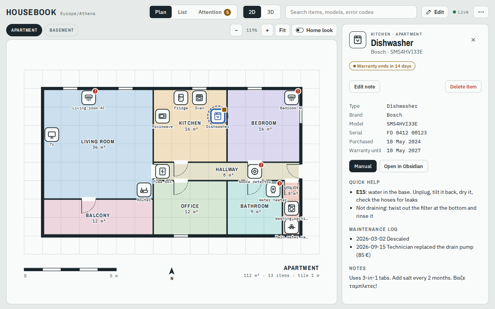
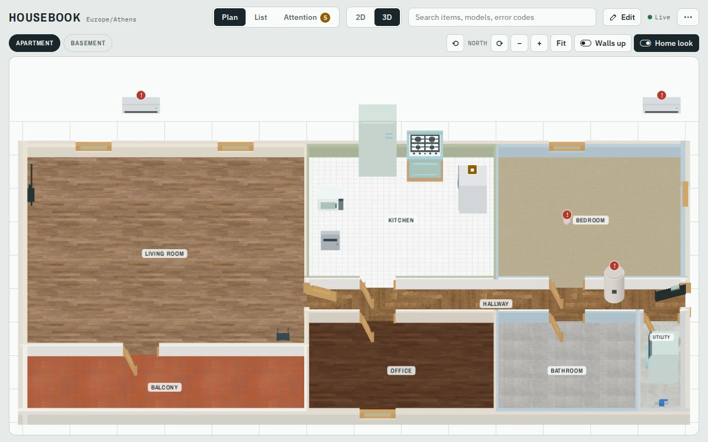
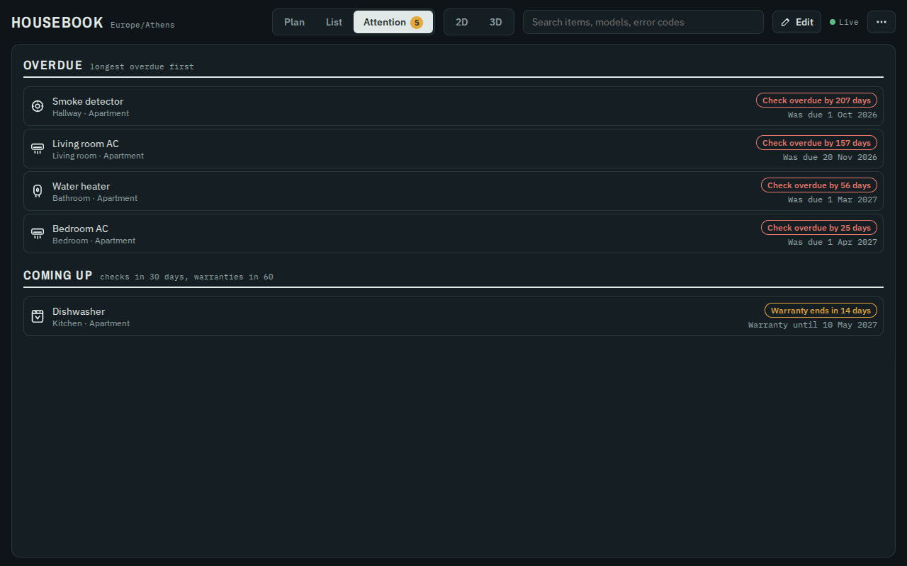
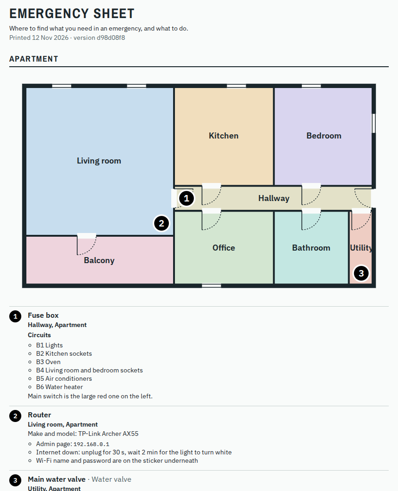

# Housebook

[](https://github.com/deepblue597/housebook/actions/workflows/ci.yml)
[](https://github.com/deepblue597/housebook/releases)
[](LICENSE)

**[Project page](https://deepblue597.github.io/housebook/)** · [Install](#install) ·
[Releases](https://github.com/deepblue597/housebook/releases)

Self-hosted household app: a plan of your home where clicking an appliance shows its manual,
warranty, quick fixes and maintenance log. Item info is plain Markdown with YAML frontmatter
(Obsidian-compatible, Obsidian optional); the layout is `house.json`. One Docker container,
one household.



<table>
  <tr>
    <td width="66%" valign="top">
      <br>
      <sub>The 3D view with the home look (floor and wall finishes)</sub><br><br>
      <br>
      <sub>Attention: overdue checks and warranties ending soon (dark mode)</sub>
    </td>
    <td width="34%" valign="top">
      <br>
      <sub>On a phone</sub>
    </td>
  </tr>
  <tr>
    <td colspan="2">
      <br>
      <sub>The printable emergency sheet: where the fuse box, router and water valve are, and what to do</sub>
    </td>
  </tr>
</table>

Screenshots show the example house in `examples/house` (finishes added for the 3D view).

## What it does

- **A plan of your home.** Draw the rooms, doors, windows and open-plan spaces of each floor and
  see them in 2D or 3D, with floor finishes and wall paint or wallpaper.
- **Everything about each appliance in one place.** Click the boiler or the dishwasher for its
  manual, warranty, quick fixes for common errors, maintenance log, photos and receipts, including
  receipts kept in [Paperless-ngx](https://docs.paperless-ngx.com/).
- **What needs attention.** Overdue checks, maintenance due soon and warranties about to end, also
  as a calendar feed for Google, Apple, Outlook or Thunderbird.
- **Ready for emergencies.** A printable sheet of where the water valve, fuse box and gas valve
  are and what to do, QR stickers that open an item on your phone, and the last data you saw
  stays readable offline.
- **Your files, not a database.** Each item is a Markdown note with YAML frontmatter and the
  layout is one `house.json`, in a folder you can back up, sync or open in Obsidian (optional).
  Changes made outside the app show up at once.
- **Household-sized.** One Docker container for amd64 and arm64 (Raspberry Pi 4/5). No login on
  a home network or Tailscale, or sign-in through a login proxy or with Keycloak, Authentik or
  Authelia. Editors change things; viewers look.

**Status:** 0.1.0, the first release ([CHANGELOG.md](CHANGELOG.md)). Before 1.0 a new minor
version may change the data format: Housebook upgrades older files by itself, but take a backup
before upgrading. What comes next: [docs/ROADMAP.md](docs/ROADMAP.md).

## Install

You need Docker with Compose on a machine that stays on (a home server, a NAS, a Raspberry Pi
4/5):

```sh
mkdir housebook && cd housebook
curl -fsSLO https://raw.githubusercontent.com/deepblue597/housebook/main/deploy/compose.yaml
mkdir data
printf 'HB_UID=%s\nHB_GID=%s\nTZ=Europe/Athens\n' "$(id -u)" "$(id -g)" > .env   # your time zone
docker compose up -d
```

Open http://127.0.0.1:8000 and draw your first room. Your house is stored as plain files in
`data/`. Next:

- **Phones:** to open it from other devices, set `HB_BIND` in `.env` to this machine's address
  on your home network or tailnet. There is no login in this setup, so never make it reachable
  from the internet; [docs/login.md](docs/login.md) explains when you need one and how to add it.
- **Backups:** back up the `data` folder ([docs/backup.md](docs/backup.md)).
- **Upgrading:** download a backup (⋯ menu), then `docker compose pull && docker compose up -d`.

The comments in [deploy/compose.yaml](deploy/compose.yaml) list every setting it reads from `.env`.

## Going further

- **Settings:** every environment variable, the Docker image, reverse proxies (live updates,
  upload size) and HTTPS for offline use: [docs/configuration.md](docs/configuration.md).
- **Login:** which mode to choose and how to set each up: [docs/login.md](docs/login.md).
- **Backups and restoring:** [docs/backup.md](docs/backup.md).
- **API**, for scripts and integrations: [docs/api.md](docs/api.md).
- **How it works:** file formats and rules in [docs/data-contract.md](docs/data-contract.md),
  architecture and decisions in [docs/DESIGN.md](docs/DESIGN.md).

## Contributing

Bug reports and pull requests are welcome. [CONTRIBUTING.md](CONTRIBUTING.md) covers the setup
(`make setup && make dev`), the checks and where things live. Please report security problems
privately, as [SECURITY.md](SECURITY.md) explains.

## License

Housebook is free software: you can redistribute it and/or modify it under the terms of the
[GNU Affero General Public License](LICENSE), version 3 or (at your option) any later version.
In short: you may run, change and share it; if you let other people use a changed version over a
network, you must offer them its source code.
